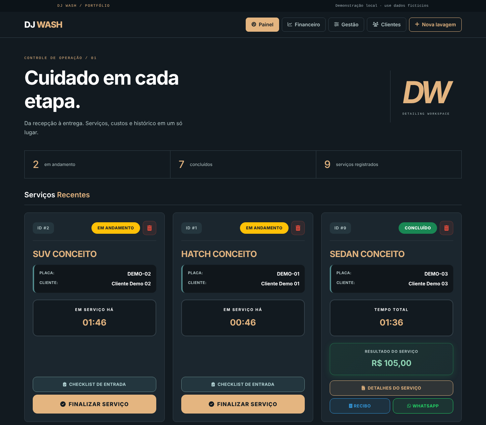
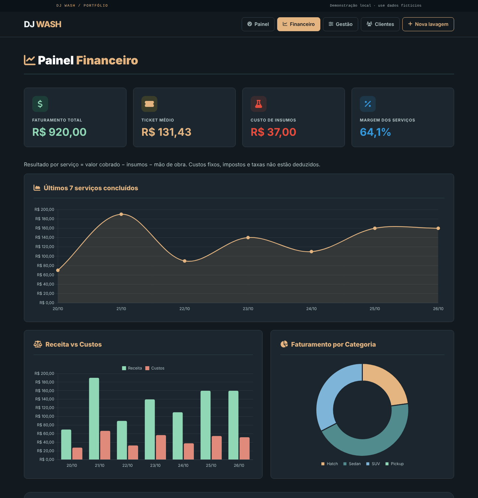
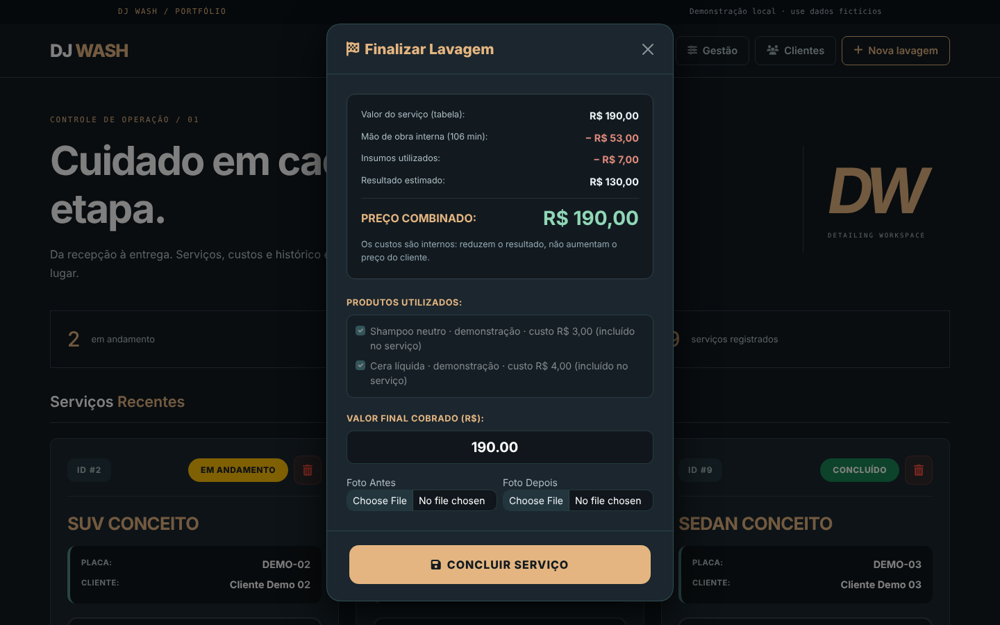
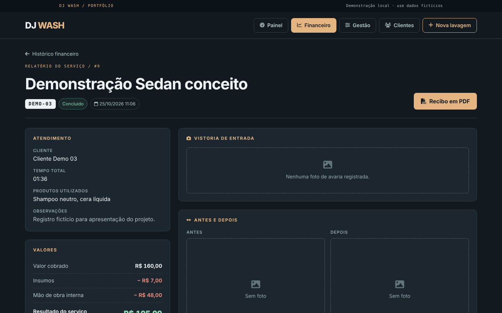
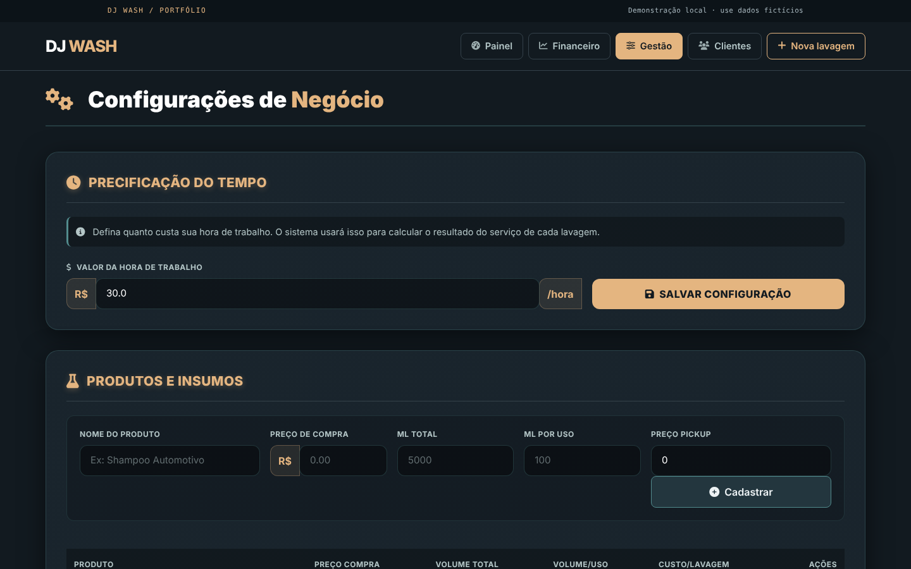
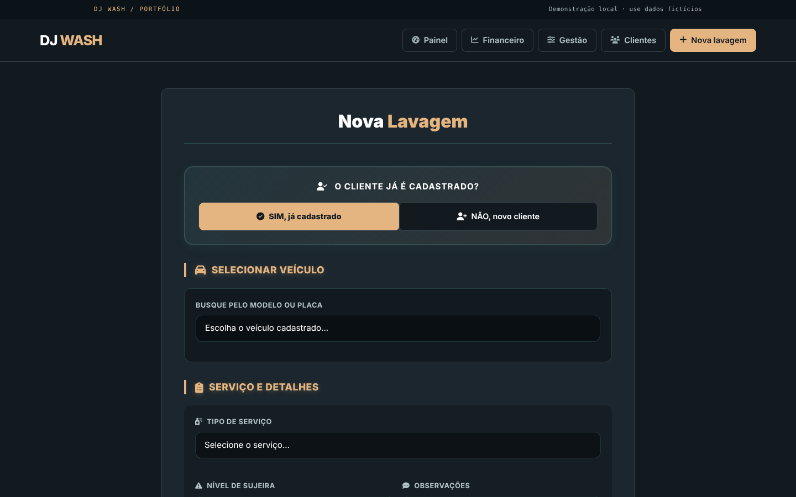
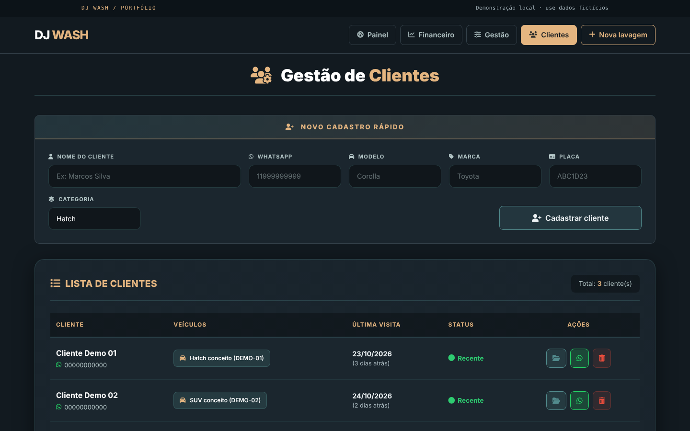
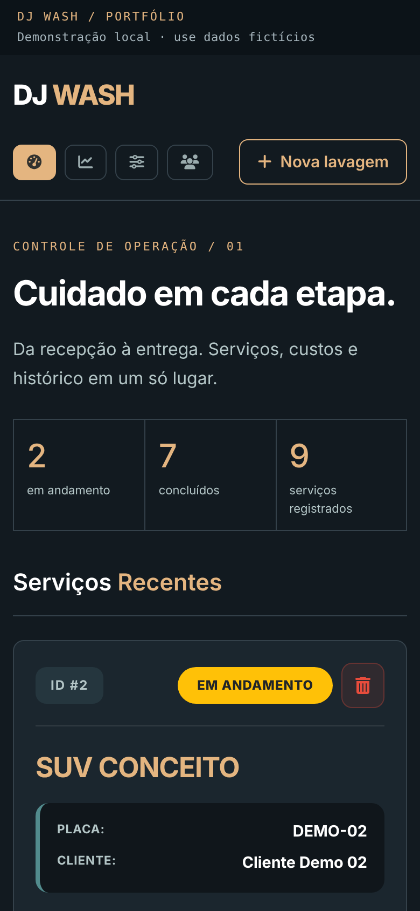

<div align="center">

# DJ WASH

**Gestão de estética automotiva, da entrada à entrega.**

Cadastro de clientes e veículos, checklist de entrada, serviços em andamento,
custos por atendimento, fotos de antes/depois e recibo em PDF — em uma aplicação web local.

[](https://github.com/alex10presam-lang/Estetica-Automotiva-Python/actions/workflows/tests.yml)


[Executar](#executar-localmente) · [Roteiro de demonstração](#experimente-em-cinco-passos) · [Arquitetura](docs/architecture.md) · [Testes](#qualidade-e-testes)

</div>



<sub>Captura da aplicação em execução. Clientes, placas e valores da demonstração são fictícios.</sub>

## Leitura rápida do projeto

- **Foco:** aplicação web em Python, modelagem de atendimentos e acompanhamento de custos.
- **Evidência técnica:** [modelos relacionais](app/models.py), [validações e tratamento de fotos](app/services.py) e [testes do fluxo](tests/test_workflow.py).
- **Para avaliar:** percorra a [demonstração em cinco passos](#experimente-em-cinco-passos), da inspeção à conferência de custos e ao recibo.
- **Estado:** demonstração local com dados fictícios, sem autenticação; o resultado por serviço não representa lucro líquido contábil.

## O que o projeto resolve

Um serviço de estética automotiva reúne informações que costumam ficar espalhadas: cadastro,
condições do veículo, preço combinado, produtos consumidos e tempo de trabalho. O DJ WASH organiza
essas etapas em um fluxo único, com registro por atendimento.

| Etapa | Recursos |
| --- | --- |
| **Recepção** | Cadastro de cliente e veículo; preço por categoria e adicional por nível de sujeira |
| **Inspeção** | Combustível, observações de avarias e fotografias |
| **Execução** | Painel com cronômetro dos serviços em andamento |
| **Entrega** | Conferência do preço, insumos e mão de obra; fotos de antes e depois |
| **Acompanhamento** | Painel financeiro, histórico por cliente, relatório do serviço e recibo em PDF |

O resultado de cada serviço desconta insumos e mão de obra do valor cobrado. **Não é lucro líquido
contábil:** custos fixos, impostos e taxas não entram nesse cálculo.

## Telas

<table>
  <tr>
    <td width="50%"><br><b>Financeiro</b> — faturamento, ticket médio, receita × custos e faturamento por categoria.</td>
    <td width="50%"><br><b>Finalização</b> — o preço combinado é mantido; mão de obra e insumos aparecem como custo interno.</td>
  </tr>
  <tr>
    <td><br><b>Relatório do serviço</b> — atendimento, decomposição do resultado e fotos.</td>
    <td><br><b>Gestão</b> — custo da hora, insumos com custo por dose, serviços e custos fixos.</td>
  </tr>
  <tr>
    <td><br><b>Nova lavagem</b> — cliente existente ou novo, serviço e nível de sujeira.</td>
    <td><br><b>Clientes</b> — cadastro rápido, veículos, última visita e WhatsApp.</td>
  </tr>
</table>

<details>
<summary><b>Versão de celular</b> (390 px)</summary>
<br>

</details>

## Executar localmente

Requer **Python 3.12** e Git.

```bash
git clone https://github.com/alex10presam-lang/Estetica-Automotiva-Python.git
cd Estetica-Automotiva-Python
python -m venv .venv
```

Ative o ambiente:

```powershell
# Windows / PowerShell
.\.venv\Scripts\Activate.ps1
```

```bash
# Linux / macOS
source .venv/bin/activate
```

Instale, prepare a demonstração e inicie:

```bash
python -m pip install -r requirements.txt
python -m app.demo
python -m uvicorn app.main:app --reload --host 127.0.0.1
```

Abra **http://127.0.0.1:8000**. A documentação das rotas fica em **http://127.0.0.1:8000/docs**.

> [!TIP]
> No Windows, se a ativação for bloqueada pela política do PowerShell, use `.\.venv\Scripts\python.exe`
> no lugar de `python`. Não é preciso alterar a política do sistema.

O comando `app.demo` só popula um banco vazio e nunca sobrescreve cadastros existentes. Ele cria três
clientes, dois serviços em andamento e uma semana de serviços concluídos, para que o painel financeiro
tenha histórico. Para começar sem exemplos, pule esse comando: as tabelas são criadas na inicialização.

## Experimente em cinco passos

1. No **Painel**, veja os dois serviços em andamento com o cronômetro e os concluídos logo abaixo.
2. Abra **Financeiro** para conferir os indicadores e os gráficos da última semana.
3. Em um serviço em andamento, abra o **Checklist de entrada** e registre uma observação ou foto fictícia.
4. Clique em **Finalizar serviço**: compare o preço combinado com os custos internos e o resultado estimado.
5. Abra **Detalhes do serviço** e gere o **recibo em PDF**.

Os telefones de exemplo são inválidos de propósito. Os links de WhatsApp apenas abrem o serviço
externo; o aplicativo não envia mensagens.

## Decisões de implementação

- **HTML renderizado no servidor:** Jinja2 monta as páginas; JavaScript cuida da finalização, do
  cronômetro e dos gráficos, sem uma aplicação front-end separada.
- **Front-end sem CDN:** Bootstrap, Font Awesome e Chart.js ficam em `app/static/vendor/`, com suas
  licenças. As telas abrem sem internet.
- **Identidade visual única:** `studio.css` define a paleta e os componentes compartilhados, e
  `_nav.html` é o cabeçalho de todas as páginas, com a seção atual destacada.
- **Formato brasileiro:** valores passam pelo filtro `brl` (R$ 1.234,56) e telefones pelo filtro
  `whatsapp`, que mantém só os dígitos e acrescenta o DDI 55 quando falta.
- **Dados locais:** SQLite e fotografias ficam em `data/`, fora do Git. O diretório pode ser alterado
  com `DJWASH_DATA_DIR`.
- **Custos separados do preço:** mão de obra e produtos afetam o resultado interno, sem aumentar o
  valor combinado com o cliente.
- **Fotografias verificadas:** JPEG, PNG e WebP são decodificados, limitados e convertidos para JPEG
  sem metadados EXIF.
- **Validação das operações:** registros ausentes retornam 404; placas duplicadas e finalização
  repetida são recusadas; vínculos impedem excluir produtos, serviços e veículos em uso.

## Estrutura

```text
app/
  main.py            Inicialização, arquivos estáticos e respostas de erro
  config.py          Diretórios e configuração do banco
  database.py        Sessões e integridade referencial
  models.py          Clientes, veículos, catálogo e atendimentos
  services.py        Validações, custo por dose, formatação e fotos
  demo.py            Base fictícia para demonstração
  routes/web.py      Fluxos HTTP e geração do recibo
  templates/         Páginas Jinja2 e o cabeçalho compartilhado (_nav.html)
  static/css/        Estilos das páginas e identidade visual (studio.css)
  static/js/         Comportamento do painel
  static/vendor/     Bootstrap, Font Awesome e Chart.js locais
tests/               Testes com banco isolado
docs/                Arquitetura e capturas reais
```

## Qualidade e testes

```bash
python -m pip install -r requirements-dev.txt
python -m pytest -q
python -m ruff check app tests
python -m ruff format --check app tests
```

A suíte (28 testes) cobre páginas vazias e preenchidas, cadastros, cálculo de custos, finalização
repetida, arquivos inválidos, preservação das fotos de inspeção, vínculos, gráficos do financeiro,
formatação em reais e emissão do PDF. Os testes usam um banco temporário.

O GitHub Actions executa os testes e o Ruff em Python 3.12. As capturas deste README foram feitas
com a demonstração em execução, em 1440 px e em 390 px.

## Escopo atual

Esta versão é uma **demonstração local para portfólio**, sem autenticação, autorização por usuário ou
proteção CSRF completa. Não exponha o servidor diretamente à internet nem use dados reais de clientes.

Ainda não há migrações de banco, conciliação de pagamentos, emissão fiscal ou suporte a vários
operadores ao mesmo tempo. Valores monetários usam `Float`; uma evolução comercial deve adotar
precisão decimal. Consulte [os detalhes técnicos](docs/architecture.md) para limites e próximos passos.

Banco, fotos, QR de pagamento e relatórios antigos foram retirados da versão atual. **Essa limpeza não
remove os arquivos de commits anteriores.**
