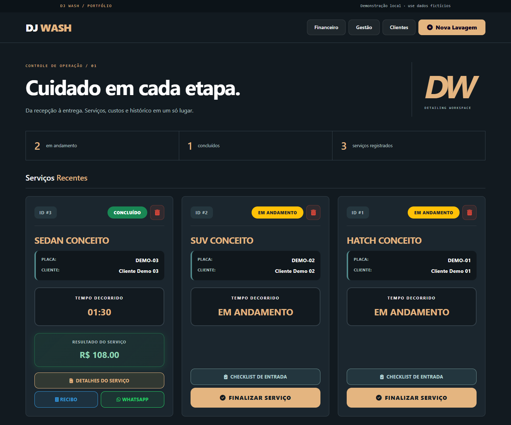
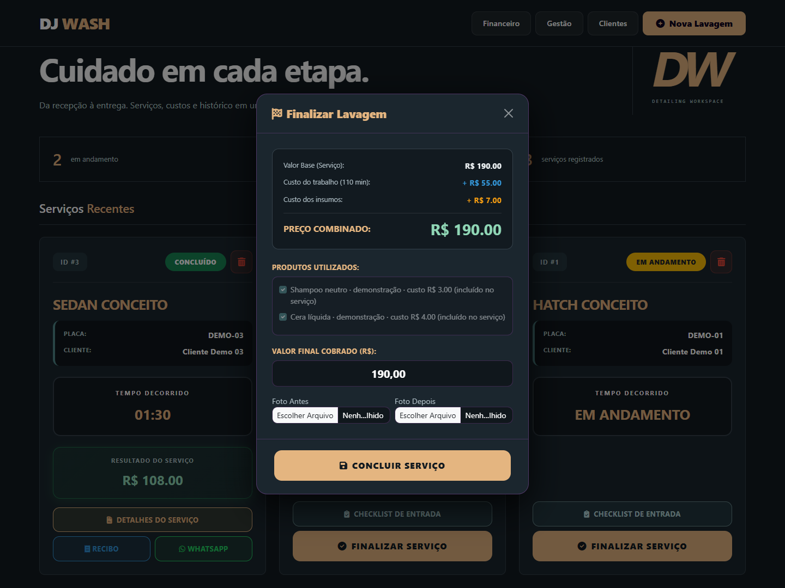
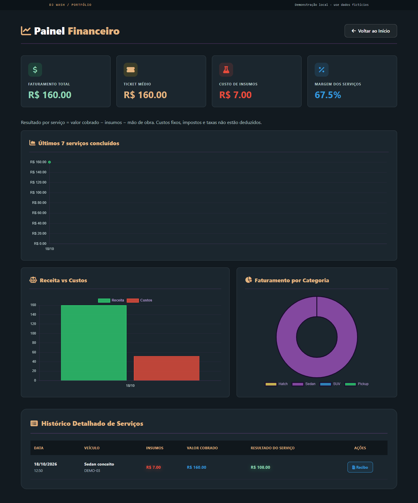

# DJ WASH

### Gestão de estética automotiva, da entrada à entrega.

Aplicação web em Python para cadastrar clientes e veículos, registrar a inspeção de entrada, acompanhar serviços e conferir seus custos. O atendimento termina com fotos de entrega, histórico e recibo em PDF.

**FastAPI · SQLAlchemy · SQLite · Jinja2 · Bootstrap · ReportLab**

[Como executar](#executar-localmente) · [Fluxo de demonstração](#experimente-em-cinco-passos) · [Arquitetura](docs/architecture.md) · [Testes](#qualidade-e-testes)



*Captura do aplicativo em execução. Clientes, placas e valores da demonstração são fictícios.*

## O que o projeto resolve

Um serviço de estética automotiva reúne informações que costumam ficar separadas: cadastro, condições do veículo, preço combinado, produtos consumidos e tempo de trabalho. O DJ WASH organiza essas etapas em um fluxo local, com registro por atendimento.

| Etapa | Recursos |
| --- | --- |
| Recepção | Cadastro de cliente e veículo; preço por categoria e adicional de sujeira |
| Inspeção | Combustível, observações de avarias e fotografias |
| Execução | Painel com serviços em andamento e concluídos |
| Entrega | Revisão do valor cobrado, insumos e fotos de antes/depois |
| Acompanhamento | Histórico por cliente, indicadores dos registros e recibo em PDF |

O resultado de cada serviço desconta insumos e mão de obra do valor cobrado. **Não representa lucro líquido contábil:** custos fixos, impostos e taxas não são deduzidos desse cálculo.

## Executar localmente

Requer **Python 3.12** e Git. Execute os comandos na pasta do repositório.

```bash
git clone https://github.com/alex10presam-lang/Estetica-Automotiva-Python.git
cd Estetica-Automotiva-Python
python -m venv .venv
```

Ative o ambiente:

```powershell
# Windows / PowerShell
.\.venv\Scripts\Activate.ps1
```

```bash
# Linux / macOS
source .venv/bin/activate
```

Instale, prepare a demonstração e inicie:

```bash
python -m pip install -r requirements.txt
python -m app.demo
python -m uvicorn app.main:app --reload --host 127.0.0.1
```

Abra **http://127.0.0.1:8000**. A documentação das rotas fica em **http://127.0.0.1:8000/docs**.

No Windows, caso a ativação seja bloqueada pela política do PowerShell, use `.\.venv\Scripts\python.exe` no lugar de `python` nos comandos; não é necessário alterar a política do sistema.

O comando `app.demo` só popula um banco vazio. Ele não sobrescreve cadastros existentes. Para começar sem exemplos, pule esse comando: as tabelas são criadas na inicialização.

## Experimente em cinco passos

1. Explore o painel: a demonstração contém dois serviços em andamento e um concluído.
2. Abra **Gestão** para conferir preços, custo por hora e insumos vinculados aos serviços.
3. Entre no **Checklist de Entrada** e registre uma observação ou uma foto fictícia.
4. Selecione **Finalizar Serviço**: confira os custos e mantenha ou ajuste o preço combinado.
5. Consulte o **Financeiro**, o histórico do cliente e o recibo em PDF.

Os telefones de exemplo são inválidos intencionalmente. Os links de WhatsApp apenas abrem o serviço externo; o aplicativo não envia mensagens automaticamente.

<details>
<summary>Ver a finalização e o painel financeiro</summary>





</details>

## Decisões de implementação

- **HTML renderizado no servidor:** Jinja2 atende as páginas; JavaScript controla a finalização e os gráficos, sem exigir uma aplicação frontend separada.
- **Dados locais:** SQLite e fotografias ficam em `data/`, fora dos arquivos versionados. O diretório pode ser alterado com `DJWASH_DATA_DIR`.
- **Custos separados do preço:** mão de obra e produtos afetam o resultado interno, sem aumentar automaticamente o valor combinado com o cliente.
- **Insumos sem duplicidade:** os itens do catálogo são incluídos uma única vez, mesmo quando um identificador é repetido no formulário.
- **Fotografias verificadas:** JPEG, PNG e WebP são decodificados, limitados e convertidos para JPEG sem metadados EXIF. O checklist é preservado ao adicionar a foto de entrega.
- **Validação de operações:** registros ausentes retornam 404; placas duplicadas e finalização repetida são recusadas; vínculos impedem a exclusão de produtos, serviços e veículos em uso.

## Estrutura

```text
app/
  main.py            Inicialização, arquivos estáticos e respostas de erro
  config.py          Diretórios e configuração do banco
  database.py        Sessões e integridade referencial
  models.py          Clientes, veículos, catálogo e atendimentos
  services.py        Validações, custo por dose e tratamento de fotos
  demo.py            Base fictícia para demonstração
  routes/web.py      Fluxos HTTP e geração do recibo
  templates/         Páginas Jinja2
  static/css/        Estilos das páginas e identidade visual compartilhada
  static/js/         Comportamento do painel
tests/               Testes com banco isolado
docs/                Arquitetura e capturas reais
```

## Qualidade e testes

```bash
python -m pip install -r requirements-dev.txt
python -m pytest -q
python -m ruff check app tests
python -m ruff format --check app tests
```

A suíte verifica páginas vazias e preenchidas, cadastros, cálculo de custos, finalização repetida, arquivos inválidos, preservação das fotos de inspeção, vínculos e emissão do PDF. Os testes usam um banco temporário, sem abrir a base local de uso.

O GitHub Actions executa os testes e as verificações de código em Python 3.12. A interface também foi conferida no Edge, em desktop e largura de 390 px; as capturas deste README vieram dessa execução.

## Escopo atual

Esta versão é uma **demonstração local para portfólio**, sem autenticação, autorização por usuário ou proteção CSRF completa. Não exponha o servidor diretamente à internet nem use dados reais de clientes. Bootstrap, ícones e gráficos são carregados de CDNs e precisam de conexão.

O projeto ainda não inclui migrações de banco, conciliação de pagamentos, emissão fiscal ou garantias para múltiplos operadores simultâneos. Valores monetários usam `Float` no modelo original; uma evolução para uso comercial deve adotar precisão decimal e regras financeiras mais completas.

Banco, fotos, QR de pagamento e relatórios antigos foram retirados da versão atual. **Essa limpeza não remove os arquivos de commits anteriores.** Consulte [os detalhes técnicos](docs/architecture.md) para conhecer os limites e próximos passos.
